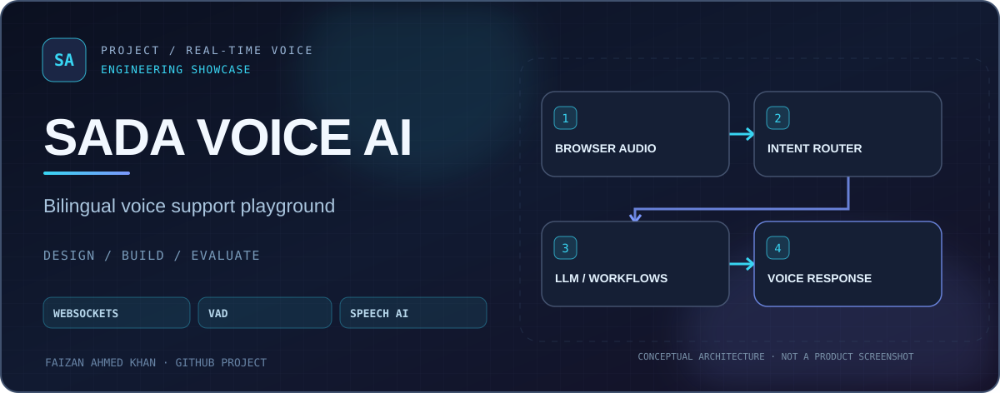
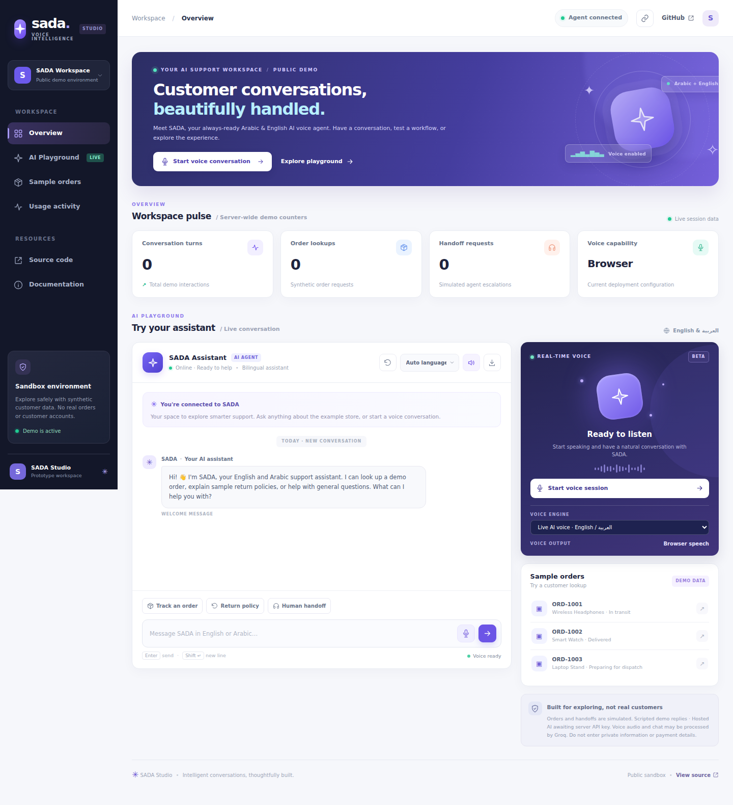
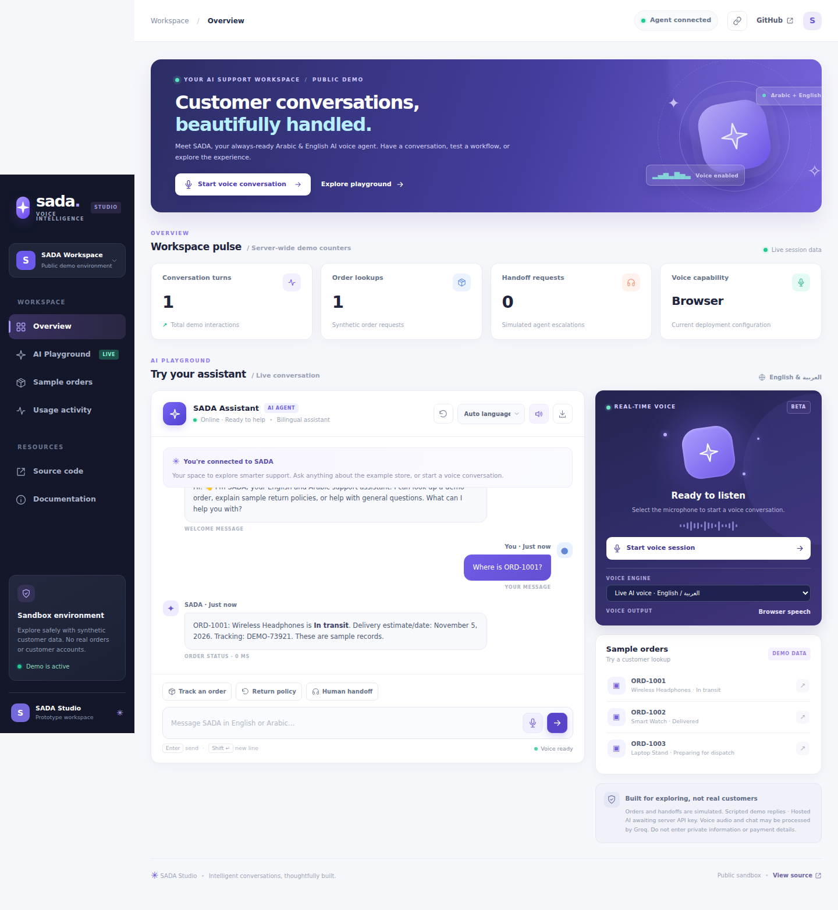
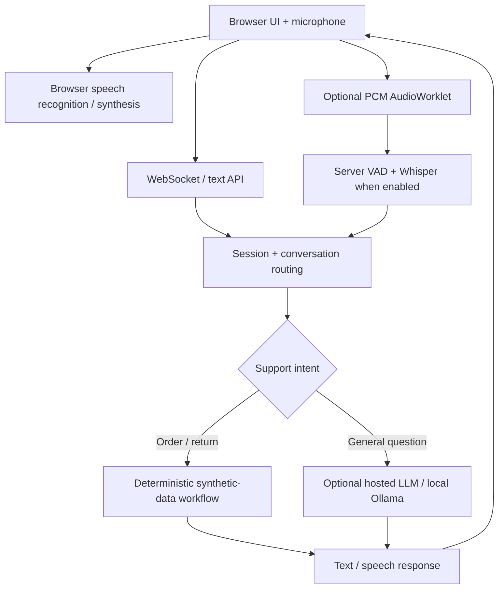

<div align="center">
  <a href="https://github.com/FaizanAKhan786/sada-voice-ai"></a>
  <br />


# SADA Voice AI | صدى
### Bilingual, interruptible voice-support prototype

**Arabic + English · Browser speech · WebSockets · FastAPI · Optional LLM**

[](https://github.com/FaizanAKhan786/sada-voice-ai/actions/workflows/ci.yml)


[Hosted demo (availability unverified)](https://sada-voice-ai.onrender.com) · [Quick start](#quick-start) · [Architecture](#architecture) · [Deployment notes](docs/public-deployment.md)

</div>

## Product preview

<p align="center">
  
</p>

<p align="center">
  
</p>

**[Watch the real-browser walkthrough recording](docs/demo/sada-order-walkthrough.webm)** · [Mobile screenshot](docs/screenshots/sada-mobile.png)

*Both screenshots were produced by an automated Chromium run against the actual local FastAPI/WebSocket application using synthetic orders only. See [the reproducible demo walkthrough](docs/DEMO_WALKTHROUGH.md) and [the browser capture workflow](.github/workflows/screenshots.yml).*

SADA is a **voice and text customer-support playground** with English/Arabic sample order flows, interruption handling, a SaaS-style interface and optional model-backed responses. It is a public **synthetic-data demonstration**, not a real call-center, CRM or payment integration.

### Try the demo

**[Open the hosted demo](https://sada-voice-ai.onrender.com)**. Its current availability could not be independently confirmed; free hosting may sleep or be unavailable.

Try `Where is ORD-1001?`, `Can I return an item?` or `وين طلبي ORD-١٠٠٢؟`. Do not submit personal or real customer information.

## Architecture



**Important:** The hosted demo relies primarily on browser features and optional hosted responses. It does **not** ship server-side Whisper/VAD or local Ollama inference on the free Render profile. Local streaming uses utterance-boundary transcription, not per-word streaming ASR.

## Features

| Capability | Description |
| --- | --- |
| Bilingual flows | Arabic and English greetings, orders, returns and escalation |
| Interruptible interactions | New speech can cancel an active assistant response |
| Transport | WebSockets for live sessions and PCM audio when configured |
| STT / TTS | Browser speech by default; optional local Whisper and hosted voice features |
| LLM | Configurable Groq service or local Ollama for general answers |
| Safety in the demo | Synthetic orders; basic origin and session-rate controls |

## Quick start

```bash
git clone https://github.com/FaizanAKhan786/sada-voice-ai.git
cd sada-voice-ai
python -m venv .venv
source .venv/bin/activate   # Windows: .venv\Scripts\activate
pip install -r requirements.txt
uvicorn app.main:app --reload --host 127.0.0.1 --port 8000
```

Open [localhost:8000](http://127.0.0.1:8000) and check [the health endpoint](http://127.0.0.1:8000/api/health).

For additional local components:

| Optional capability | Dependencies / guide |
| --- | --- |
| Whisper STT | [`requirements-stt.txt`](requirements-stt.txt), then `ENABLE_STT=1` |
| Local model responses | [`requirements-llm.txt`](requirements-llm.txt), Ollama and `ENABLE_OLLAMA=1` |
| Server-side voice activity detection | [`requirements-vad.txt`](requirements-vad.txt) |
| Hosted AI | [Hosted AI guide](docs/hosted-ai.md) |
| Streaming voice details | [Voice architecture](docs/voice-ai.md) |

The feature flags default to conservative settings; consult [`.env.example`](.env.example) and the linked notes before switching on external AI services.

## Quality and deployment

```bash
pip install -r requirements-dev.txt
pytest -q
```

See [verified CI results with run links and methodology](docs/VERIFIED_RESULTS.md): 37 tests passed and 30/30 supplied synthetic intent fixtures matched in the referenced CI run. These are **not** speech or LLM accuracy benchmarks.

The repo contains [CI workflows](.github/workflows/) and a [Render Blueprint](render.yaml). Deployment behavior, privacy restrictions and differences from a real contact-center system are covered in [public deployment notes](docs/public-deployment.md).

**Scope:** no real orders, verified identity, payments, CRM, telephony or human agent handoff. AI responses can be inaccurate. The public demo should be used only with sample data.

## Verification & benchmark protocol

[Read the reproducible test and evaluation guide](docs/QUALITY.md). It documents the current automated checks, commands for model-dependent evaluations, and what results **do not** establish.

[Issues](https://github.com/FaizanAKhan786/sada-voice-ai/issues) · [GitHub profile](https://github.com/FaizanAKhan786)
