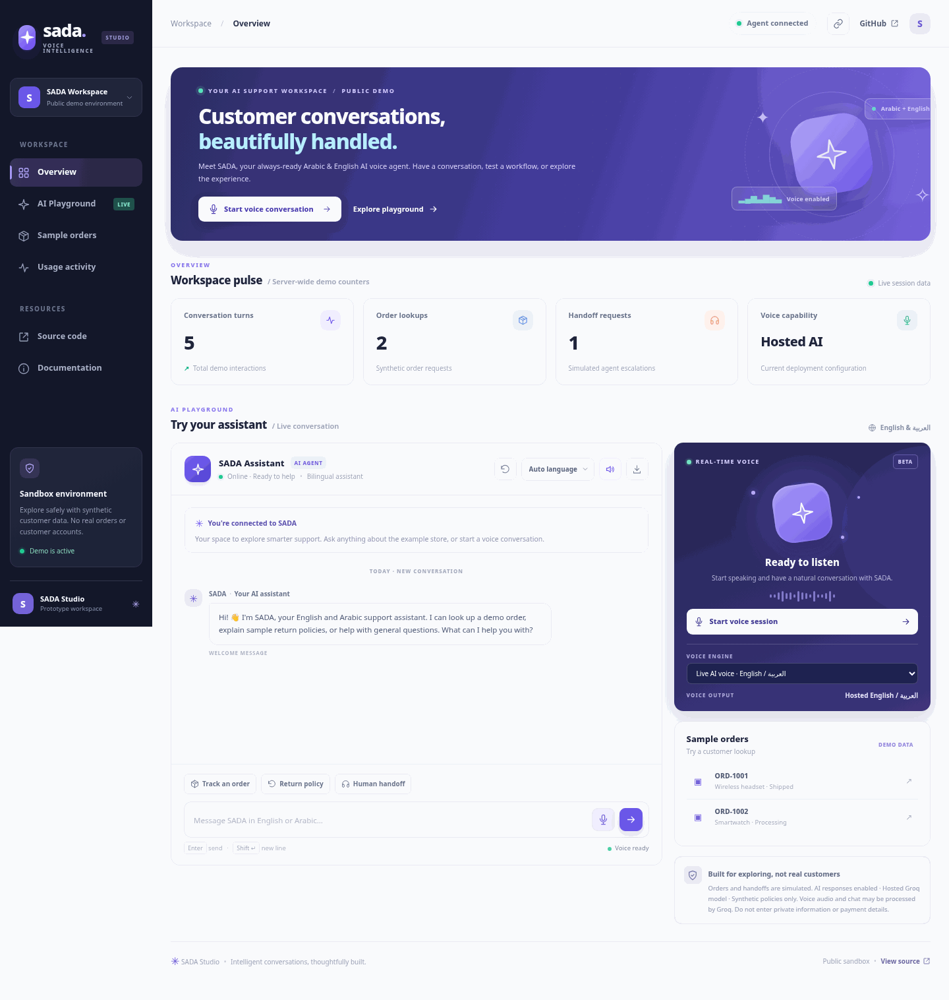
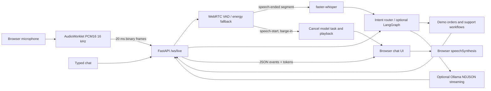

# SADA Voice AI (صدى)

**A bilingual voice-support prototype for Arabic and English, built with FastAPI, WebSockets and local speech models.**



[](https://github.com/FaizanAKhan786/sada-voice-ai/actions/workflows/ci.yml)


## Why this project

Voice assistants are easy to demo with a single recorded clip. The harder part is the conversation around it: knowing when someone has finished speaking, letting them interrupt an answer, keeping a useful context window, and not inventing order information.

SADA is my attempt to put those pieces together in a small app that runs locally. It handles a few realistic support flows using **synthetic orders**, offers Arabic and English interfaces, and can use local Whisper transcription and an Ollama model for general questions. The interface and API are designed so each part can be tested independently.

This is a **portfolio prototype**, not a deployed call-center product. Order lookup, policies and handoffs are simulated. There are no live store, payment, CRM or human-agent integrations.

## Demo

The dashboard supports text chat, browser speech input/output and optional local streaming audio. Try these examples after starting the server:

- `Where is ORD-1001?`
- `Can I return a product?`
- `وين طلبي ORD-١٠٠٢؟`
- `I need to speak to a human agent.`

The order lookup and handoff screens use invented data, so the demo works without credentials.

## Features at a glance

| Feature | How it works |
|---|---|
| Arabic + English | Bilingual intent handling and language-aware replies |
| Streaming microphone audio | Browser AudioWorklet sends 16 kHz PCM frames to `/ws/live` |
| Speech boundaries | WebRTC VAD, or an RMS-based fallback for development |
| Speech-to-text | Optional faster-whisper, run at utterance boundaries |
| Interruption | New speech cancels the active assistant response and browser playback |
| Local LLM | Optional Qwen via Ollama, streamed for general FAQs only |
| Predictable order flows | Deterministic workflows for synthetic orders, returns and escalation |
| Quality checks | Pytest, a small bilingual intent test set and GitHub Actions |

**Important distinction:** audio is transported continuously, but Whisper is called after an utterance ends. This is not word-by-word streaming ASR or a production telephony service.

## Stack

Python, FastAPI, WebSockets, JavaScript, AudioWorklet, faster-whisper, WebRTC VAD, Ollama and optional LangGraph. The default setup needs only the Python web dependencies; speech and LLM models are opt-in.

## Public demo deployment (Render)

[](https://render.com/deploy?repo=https://github.com/FaizanAKhan786/sada-voice-ai)

The included [`render.yaml`](render.yaml) deploys the FastAPI app, web dashboard, and synthetic support workflows to a public HTTPS endpoint. **This is a lightweight demonstration:** browser speech features work where supported, while server-side Whisper/VAD and local Ollama inference are disabled. Render must be connected and approved in the repository owner's account before a public URL exists. See [public deployment notes](docs/public-deployment.md) for safeguards and limitations.

## Quick start (text and browser-based voice)

```bash
cd sada-voice-ai
python -m venv .venv
source .venv/bin/activate            # Windows: .venv\Scripts\activate
pip install -r requirements.txt
uvicorn app.main:app --reload --host 127.0.0.1 --port 8000
```

Visit **http://127.0.0.1:8000**. Use the microphone input selector for browser recognition, local push-to-talk, or streaming local VAD. Chrome and Edge on desktop are recommended. For a remote device, use HTTPS with WebSocket Secure (`wss://`) and authentication before exposing the app.

**Try:** `Where is my order?` → `ORD-1001`, `What is your return policy?`, `Talk to a human agent`, `وين طلبي ORD-١٠٠٢؟`, `كيف يمكن استرداد المبلغ؟`.

## Enable local streaming speech and VAD

```bash
pip install -r requirements-vad.txt
# On Linux/macOS:
ENABLE_STT=1 WHISPER_MODEL=small uvicorn app.main:app --reload
# PowerShell:
# $env:ENABLE_STT="1"; $env:WHISPER_MODEL="small"; uvicorn app.main:app --reload
```

Select **Live streaming · local VAD** in the UI, press the microphone button once, speak, pause naturally, then speak again. You do not need to press to record individual turns. Press the mic again to stop and flush the final utterance. The browser uses an AudioWorklet and `getUserMedia` with echo cancellation, noise suppression and automatic gain control **when supported**. Use **headphones** so playback is not mistaken for a new utterance.

With `webrtcvad-wheels` installed, VAD uses the WebRTC speech detector. Otherwise the fallback detects amplitude only and is not robust to noisy rooms. The VAD requires 16 kHz signed 16-bit mono little-endian frames, each 20 ms / 640 bytes, and uses a 3-frame start window and 30-frame end-silence window. Audio frames are sent to your own server over a WebSocket; browser speech recognition mode can instead rely on a browser vendor's service.

**Offline preparation:** the first use of a named Whisper model may download weights. For air-gapped use, prefetch a compatible local faster-whisper model directory and set `WHISPER_MODEL=/absolute/path/to/model`. The runtime default is CPU INT8; CUDA can be configured using `WHISPER_DEVICE` / `WHISPER_COMPUTE` if supported. This dependency may be computationally heavy on a small laptop.

To enable **only** the older push-to-talk mode, `pip install -r requirements-stt.txt` is enough. You do not need WebRTC VAD for upload-based transcription.

## Enable the local bilingual conversational model

Install [Ollama](https://ollama.com/) on the computer running the server, then:

```bash
ollama pull qwen3:4b
pip install -r requirements-llm.txt
ENABLE_OLLAMA=1 OLLAMA_MODEL=qwen3:4b uvicorn app.main:app --reload
```

The Qwen3 4B default is an **optional** local bilingual conversation model, not included in the ZIP. It generates streamed token chunks which appear progressively in the UI; completed sentences can be spoken while the answer is still being generated. It is used **only for general, non-workflow FAQs**. The system prompt grounds it in fake policies, caps the response length and forbids claims about real accounts or actions. These safeguards are not a proof of resistance to prompt injection or hallucination. For modest RAM/VRAM, try a smaller compatible Ollama model and set `OLLAMA_MODEL` accordingly.

If Ollama is not running, the deterministic response is used. **Order-status, returns, refunds, shipping and handoff logic remain auditable and deterministic.** Optional LangGraph routing can be enabled separately:

```bash
pip install -r requirements-graph.txt
USE_LANGGRAPH=1 uvicorn app.main:app --reload
```

## Architecture



### WebSocket protocol

**Default dashboard endpoint:** `ws://127.0.0.1:8000/ws/live` (legacy text-only `/ws` retained for compatibility). The first message from the server is `{"type":"ready","sample_rate":16000,"audio_format":"pcm_s16le",...}`.

Outbound JSON commands:

```json
{"type":"message","text":"Where is ORD-1001?"}
```

Also supported: `{"type":"set_language","language":"ar"}`, `{"type":"interrupt"}`, `{"type":"flush"}`, and `{"type":"reset"}`. Binary frames in the same socket contain raw 16 kHz PCM16 little-endian mono samples, nominally 640 bytes per frame. The browser worklet handles capture and resampling automatically.

Events include `speech_started`, `speech_ended`, `transcript`, `answer_start`, `answer_delta`, `answer`, `interrupted`, `no_speech`, `reset_complete`, and `error`. Token streaming is optional and happens **only for general FAQ responses when Ollama is enabled**. All sessions are connection-local, all audio segments are transient, and transcripts are only exported explicitly in the browser.

### REST endpoints

| Endpoint | Purpose |
|---|---|
| `GET /` | Dashboard |
| `GET /api/health` | Server health |
| `GET /api/config` | Enabled optional features |
| `GET /api/demo-orders` | Fictional records |
| `GET /api/stats` | In-memory counters |
| `POST /api/transcribe` | Optional turn-based local STT |
| `WS /ws` | Legacy turn-based text WebSocket |
| `WS /ws/live` | Streaming audio and cancellable text/LLM WebSocket |

## Tests and evaluation

```bash
pip install -r requirements-dev.txt
python -m pytest -q
python -m scripts.evaluate
node --check web/app.js   # optional Node.js syntax check
```

Tests cover deterministic English/Arabic workflows, HTTP endpoints, WebSocket sessions, VAD segmentation, audio-to-transcript events using a **mock** ASR, token streaming using a **mock** Ollama generator, and task cancellation. The 30 bilingual intent examples are a small curated dataset, **not an independent benchmark**. The project does not report validated real-device ASR word error rate, voice latency, hallucination rate, or customer task completion.

## Docker

```bash
docker build -t sada-voice-ai .
docker run --rm -p 8000:8000 sada-voice-ai
```

The default image intentionally excludes Whisper, VAD wheels, and Ollama/model weights. Install them in a separate deployment environment if required. Do **not** publicly expose the unauthenticated demo server or its sample API without suitable security controls.

## Before connecting real customers

1. Enforce authenticated API and WebSocket connections; validate origin, per-order authorization, per-user limits, and least-privileged tool access.
2. Integrate a synthetic CRM in development, then require explicit human approval for financial/order mutations in production.
3. Add bounded inference queues and background-worker isolation. Cancelling a Python `asyncio.to_thread` await does **not** forcibly stop the underlying Whisper inference thread.
4. Add privacy consent, audio handling/retention rules, transport encryption, audited request metadata, and test-driven resilience to prompt injection.
5. Replace browser-specific TTS with controlled English/Arabic streaming audio, integrate AEC, evaluate accents/dialects and noisy conditions, and benchmark first-token/first-audio/turn latency on real hardware.
6. Build held-out intent/ASR/hallucination test sets and load tests; add OTEL/Prometheus and reliable CRMs/handoff infrastructure.

## GitHub-ready layout

```text
sada-voice-ai/
├── app/
│   ├── main.py           # REST, legacy WebSocket, and /ws/live wiring
│   ├── live.py           # streaming audio controls and cancellation
│   ├── streaming.py      # WebRTC VAD / RMS endpointing
│   ├── speech.py         # file and streamed PCM faster-whisper
│   ├── llm.py            # optional Ollama incremental generation
│   ├── engine.py         # safe synthetic order/policy workflows
│   └── graph.py          # optional LangGraph
├── web/
│   ├── index.html
│   ├── app.js            # client events, barge-in, TTS, UI
│   ├── pcm-worklet.js    # 20ms PCM audio packets
│   └── style.css
├── tests/                # 18 automated tests
├── scripts/              # 30-example intent evaluation
├── .github/workflows/ci.yml
├── .env.example
├── requirements*.txt
├── Dockerfile
└── README.md
```

**Resume entry, after running and validating locally:**

> **SADA | Arabic-English Streaming Voice Support Agent** | FastAPI, WebSockets, AudioWorklet, faster-whisper, WebRTC VAD, Ollama, Docker
>
> - Engineered a bilingual voice-support demo with 20 ms PCM audio streaming, silence-based endpointing, cancellable conversations and sentence-level browser speech playback.
> - Implemented deterministic order tracking and human-handoff simulation with optional policy-grounded, locally streamed LLM answers.
> - Created automated API, audio-stream, interrupt-handling and bilingual intent tests, with CI and synthetic data safeguards.

Do not claim the optional ASR/LLM operated successfully on real audio/model hardware until you run the integrations yourself. No private data, API secrets, model weights or audio recordings are included in the repository.

## References

- [FastAPI WebSockets](https://fastapi.tiangolo.com/advanced/websockets/)
- [MDN AudioWorkletProcessor](https://developer.mozilla.org/en-US/docs/Web/API/AudioWorkletProcessor/process)
- [faster-whisper](https://github.com/SYSTRAN/faster-whisper)
- [WebRTC VAD](https://github.com/wiseman/py-webrtcvad)
- [Ollama streaming chat API](https://docs.ollama.com/api)
