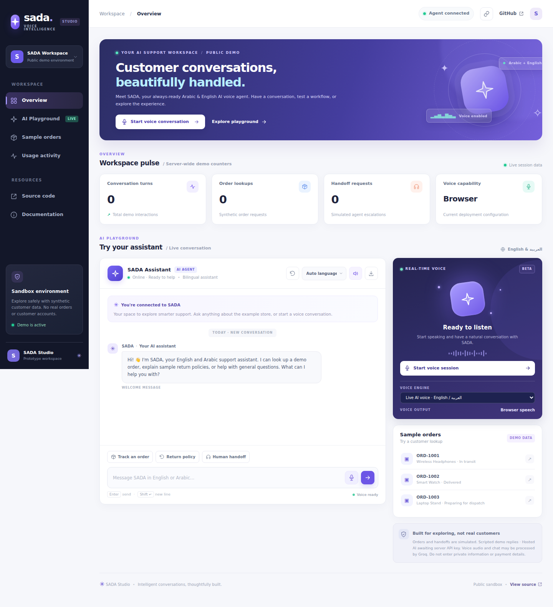
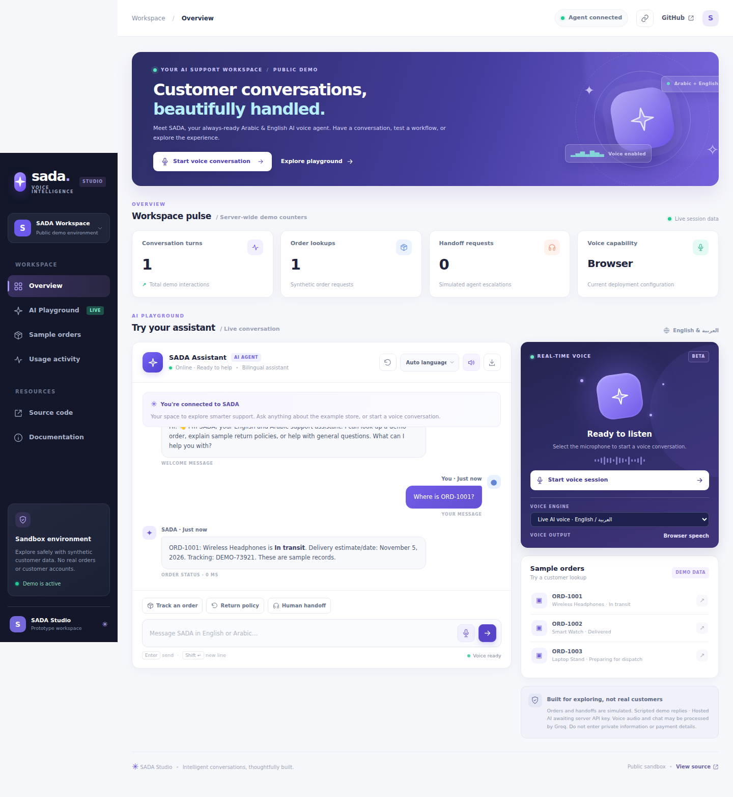

# SADA Studio | Verified demo walkthrough

These steps are reproducible on a **local copy of the actual FastAPI application**. The screenshots below were created in a headless Chromium browser by [the GitHub Actions workflow](../.github/workflows/screenshots.yml), not illustrated or generated by a design model.

## Preview evidence

| Real dashboard | Synthetic order conversation |
| --- | --- |
|  |  |

Screenshot source: [`scripts/capture_demo.py`](../scripts/capture_demo.py). The script starts after the server is healthy and checks that the browser establishes its real WebSocket connection. It then sends **`Where is ORD-1001?`**, verifies the returned synthetic order ID, and captures the conversation. No external LLM, private customer data, or model accuracy claim is involved.

## Real video and mobile preview

- [Browser-recorded synthetic order walkthrough (WebM)](demo/sada-order-walkthrough.webm). This is the actual Playwright browser session showing the app and an order request, not a mocked animation or generated video.
- [Mobile viewport screenshot](screenshots/sada-mobile.png), captured by Chromium at 390 × 844.

## Reproduce locally

Requirements: Python 3.11+; Chrome/Chromium for the browser; Playwright if you want the same automated screenshot test.

```bash
git clone https://github.com/FaizanAKhan786/sada-voice-ai.git
cd sada-voice-ai
python -m venv .venv
source .venv/bin/activate
pip install -r requirements-dev.txt
uvicorn app.main:app --host 127.0.0.1 --port 8765
```

Open `http://127.0.0.1:8765` and wait for **Agent connected**. Enter `Where is ORD-1001?`. Try Arabic with `وين طلبي ORD-١٠٠٢؟`; the order information remains **synthetic**.

To reproduce the automated screenshots on a machine with Playwright and its Chromium installed:

```bash
pip install playwright
python -m playwright install chromium
python scripts/capture_demo.py
```

This writes `docs/screenshots/sada-dashboard.png` and `sada-order-demo.png` after the assertions pass. The CI workflow additionally uploads screenshots as a job artifact.

## Walkthrough storyboard (60 to 90 seconds)

| Section | Demonstration | Evidence |
| --- | --- | --- |
| 1. Overview | Open the responsive studio and explain that it uses synthetic data. | Dashboard screenshot |
| 2. Connection | Wait for the WebSocket connection indicator. | Browser runtime assertion |
| 3. Order lookup | Ask for order `ORD-1001`; show the actual deterministic answer. | Order-chat screenshot |
| 4. Arabic | Switch to Arabic and test a synthetic Arabic order request. | Manual extension; not yet in captured CI screenshots |
| 5. Voice | Demonstrate browser recognition/output in a supported browser after microphone permission. | Manual extension; no automated voice microphone recording is claimed |
| 6. Architecture | Open the architecture and deployment notes. | [Voice notes](voice-ai.md) |

## What the verification does not prove

The browser test proves **local server startup, page rendering, live WebSocket connectivity and one synthetic text-chat flow**. It does not establish reliable public hosting, voice recognition quality, interruption latency, real CRM integration, or large-model inference performance.

Run the general [quality checks](QUALITY.md) separately. If the hosted demo is temporarily unavailable, reproduce the local workflow rather than claiming it is live.
